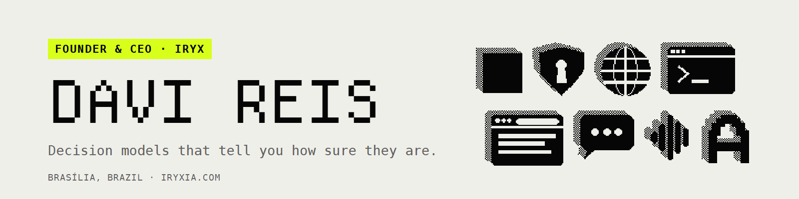

<picture>
  <source media="(prefers-color-scheme: dark)" srcset="assets/banner-escuro.png">
  
</picture>

 

I'm the founder and CEO of **[Iryx](https://www.iryxia.com)**, an AI company from Brasília, Brazil.

We build **decision models**. A model gets a context and closed questions, answers each one, and says how sure it is. When the confidence is high, the software moves on alone. When it is low, the case goes to a person. The final call stays human.

> **Você decide. O Iryx também.** 
> *You decide. So does Iryx.*

 

### ▚ What I'm building

| | Product | What it is | Status |
|:-:|---|---|---|
| ■ | **[Iryx Decide](https://www.iryxia.com)** | Closed decisions by API, with the confidence of each answer | Live · v1.1 since 23.11.2026 |
| ▤ | **Iryx Web Browser** | A light browser with no telemetry and no trackers | Final stage, in internal use |
| ▸ | **Iryx Harness** | A software agent: it observes, organizes, questions and proposes | Final stage, in internal use |
| ◍ | **Iryx Chat** | Conversation automation for Instagram, WhatsApp and more | Closed beta |
| ◖ | **Iryx Eco** | Dictate and listen on your computer, with no cloud | Internal use, closed beta |
| A | **[Iryx Dislexfy](https://dislexfy.com)** | Easier reading on the web for people with dyslexia | In development |
| ◆ | **Iryx S** and **Iryx G** | A model for network security decisions, and a general model | Research |

Status as published on [iryxia.com](https://www.iryxia.com).

 

### ▚ Open source

| Repository | What it does |
|---|---|
| **[Atlaz](https://github.com/Thryki/Atlaz)** | Layered memory in plain text files, so an AI agent finds what it needs fast and cheap. Python. |
| **[mikrodeck](https://github.com/Thryki/mikrodeck)** | Turns the Maschine Mikro MK3 into a shortcut controller: pads, pages, knob, touch strip and screen, over raw HID, with no vendor driver. Rust. |
| **[eleven-widget-for-windows](https://github.com/Thryki/eleven-widget-for-windows)** | Turns an ElevenLabs voice agent into a floating voice app for Windows. JavaScript. |

 

### ▚ What I do

- **AI products.** Decision models, agents and the software around them, from the model to the interface.
- **Design.** Art direction, branding, UX/UI and visual systems. At Iryx, design is not a layer: it is in the model, the software and the interface.
- **Web and systems.** Websites, platforms, internal tools and automation.
- **Infrastructure.** Networks, servers and local AI.
- **Audio and video.** Audiovisual production. Former DJ and music producer: synthesis, mixing and mastering.

 

### ▚ Also on my desk

- **Frontier Deployed Engineer** at Akza Agency: AI turned into working systems for brand, content and infrastructure.
- **Creative Director and Systems Developer** at Instituto Sarando as Nações, including Programa Incubadora Digital, a free public tech-education program in the Federal District: brand, platforms and the physical hub's network and studio.
- **Design and technology** for brands, events and education projects in Brasília.

 

### ▚ Stack

 

### ▚ Contact

Made in Brasília, Brazil.
